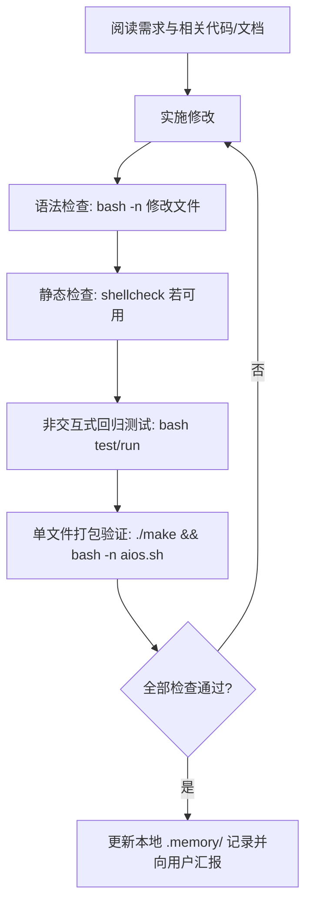

# AGENTS.md — AIOS AI Agent Guidelines

本文档为所有在此代码库上工作的 AI Agent 提供指引与约束规范。在对项目进行任何修改前，请务必完整阅读并严格遵守以下准则。

---

## 1. 项目架构概述

- **模块化源码 + 单文件打包**：源码按功能拆分在 `core`、`env`、`ver`、`utils/*`、`src/*`，通过 `make` + `build` 静态展开全部 `Include` 语句打包为单文件可执行脚本 `aios.sh`（运行时按软链名 `$self` 分发到 `src/$self`）。
- **构建与调试系统**：
  - 本地开发调试：`./debug [tv|v2|x|nx|or|cf|rc|dr|ha|tt|...] [args]`
  - 静态打包发布：`./make`（生成 `aios.sh`）或 `./make install`
  - 多语言提取：`i18n/make-pot.sh`
- **命令行入口**：
  - 统一脚本：`aios.sh`（软链分发：`v2` V2Ray、`x` Xray、`nx` Nginx、`or` OpenResty、`tv` FFmpeg/IPTV、`cf` Cloudflare、`rc` Rclone、`dr` Docker、`ha` HAProxy、`pve` Proxmox VE、`arm` Armbian、`ibm` IBM CF、`cx` Xtream Codes、`ali` OpenList、`cw` Calibre、`lhh` LianHuanHua）
  - 测试入口：`bash test/run`（顶层 `test/` 目录非交互式全流程测试，支持 `--show-output`）及 `./debug tt`
- **主要能力**：纯 Bash + `jq` 驱动的多服务运维管理面板，重点涵盖 V2Ray / Xray / Nginx / OpenResty / IPTV / Docker / Rclone 等配置管理与自动化部署。

---

## 2. 核心铁律（强制执行）

### 铁律 1：语法检查、静态检查与打包验证（Syntax, Lint & Build Check）

- **要求**：任何对 Shell 脚本源码的修改，必须在交付前通过语法检查、打包验证（如涉及 `Include` 或发布入口变更）及 `.shellcheckrc` 约束，确保 **0 语法错误**。
- **执行命令**：
  ```bash
  # 对修改的模块执行 Bash 语法检查
  bash -n <modified_file>
  # 验证单文件静态打包（检查 Include 路径完整且产物无语法错误）
  ./make && bash -n aios.sh
  # 若本机已安装 shellcheck，按仓库 .shellcheckrc 检查
  shellcheck -x <modified_file>
  ```
- **打包约束**：跨文件引用一律使用 `Include path/to/file "$@"`，严禁使用裸 `source` 或 `.` 加载项目内模块，避免 `build` 静态展开遗漏。

---

### 铁律 2：严格遵守原作者代码格式与 Bash 3.2+ 兼容性

- **代码格式规范**：
  - 函数名使用 `PascalCase`，左花括号 `{` 独占下一行：
    ```bash
    ModuleAction()
    {
        ...
    }
    ```
  - 统一使用 **4 空格缩进**，禁止混用 Tab，避免尾随空格。
  - `if` / `elif` / `else` / `then` / `fi` 与 `for` / `while` / `do` / `done` 关键字独占一行（不写 `if ...; then`）。
  - **C 风格 `for` 循环**：严格沿用原作者 `for((i=0;i<n;i++));` 紧凑写法（`for` 与 `((` 之间**无空格**、分号后无空格、末尾带 `;`），严禁写成 `for ((i=0; i<n; i++))`。
  - **重定向与比较符号**：重定向保留空格（`2> /dev/null`、`> /dev/null`，不写 `2>/dev/null`）；常规条件判断优先使用 `[ ... ]`（`.shellcheckrc` 已禁用 `SC2292,SC2250`），字符串相等用 `==`（`[ "$a" == "$b" ]`），布尔值用 `=`（`[ "$flag" = true ]`），正则 `=~` 与 extglob 使用 `[[ ... ]]`。
  - **逻辑块空行与禁止防御性 `declare -F`**：普通语句或 `fi`/`done`/`esac` 之后若紧跟新的 `if` 块，必须保留一个空行（严禁无空行紧贴堆叠）；严禁用 `if declare -F ...` 掩盖缺失的 `Include`，必须显式 `Include` 依赖或拆出独立纯函数库。
  - 全局常量 `UPPER_SNAKE_CASE` 定义在 `env`；普通与局部变量 `lower_snake_case`，数组显式初始化 `local arr=()`。
  - 终端输出使用 `Println` + 颜色/缩进变量（`${green}` / `${red}` / `${normal}` / `$info` / `$error` / `$tip` / `${indent_6}`），交互使用 `utils/inquirer`，国际化使用 `gettext` / `eval_gettext`。
- **目录与文件命名铁律（禁止 `.sh` 后缀）**：
  - 非交互式自动化测试统一放置在项目顶层 `test/` 目录（如 `test/run`、`test/lib/*`、`test/suites/*`）。
  - **`test/`、`src/`、`utils/` 三个目录下的任何文件都绝对禁止带有 `.sh` 后缀**（仅根目录/发布产物如 `aios.sh` 及 `scripts/`、`i18n/` 辅助脚本除外）。
- **双端与 Bash 4.4+ 兼容**：代码需兼容 Linux 与 macOS，最低运行环境定为 **Bash 4.4+**（现代 Linux 发行版均自带 4.4~5.2；macOS 入口脚本 `make`/`aios.sh`/`debug`/`test/run` 统一使用 `#!/usr/bin/env bash`，并在启动头检测 `BASH_VERSINFO < 4.4` 时自动 `exec` 切换至 `/opt/homebrew/bin/bash` 或 `/usr/local/bin/bash`，未安装则提示 `brew install bash`）。核心库（如 `utils/jq`、`core`）对可能为空的数组仍推荐 `${arr[@]+"${arr[@]}"}` 防御写法，避免被旧环境单独 source 时触发 `unbound variable`。

---

### 铁律 3：必须通过非交互式自动化测试（Automated Self-Test）

- **要求**：所有核心工具库（`core`、`utils/jq`）、配置解析器（`nginx`、`v2ray`、`xray`）及 JSON 构造/渲染逻辑的改动，必须运行非交互式回归测试并 100% 通过。
- **执行命令**：
  ```bash
  bash test/run
  # 需要查看各板块真实渲染输出与生成的 JSON 时：
  bash test/run --show-output [all|core|nginx|xray|v2ray]
  ```
- **基线要求**：不得出现任何失败用例；每次修复 Bug 必须补充对应的回归断言。

---

### 铁律 4：严禁编写低价值或虚假测试（No Pseudo-Tests）

- **要求**：
  - 测试用例必须真实驱动项目源码中的生产函数（Real Execution Path），对真实 JSON/Nginx 配置输入输出做实质性断言。
  - **严禁伪测试**：坚决禁止编写「即使删掉核心修复逻辑也能通过」的空断言测试。
  - **严禁硬编码真实环境路径与敏感配置**：测试统一使用 `mktemp -d` 创建临时目录与虚构域名/UUID/密钥/端口，不得读写 `/usr/local/etc/xray/`、`/usr/local/etc/v2ray/`、`/usr/local/nginx/` 等宿主机真实目录，测试结束后清理临时文件。

---

### 铁律 5：严禁未经允许擅自改变 Git 文件状态（No Unauthorized Git Add / Stage / Unstage / Commit）

- **核心禁令**：AI Agent **绝对禁止**在没有得到用户明确许可的情况下执行任何改变 Git 暂存区（Index）或提交历史的命令：
  1. **严禁擅自 Unstage**：绝对禁止执行 `git restore --staged`、`git reset`、`git rm --cached` 等任何将用户已暂存（staged）文件取消暂存的操作！用户已暂存的内容由用户全权掌控，Agent 绝无权利触碰、撤销或改变其暂存状态。
  2. **严禁擅自 Stage / Commit**：绝对禁止未经用户明确许可自动执行 `git add`、`git stage` 或 `git commit`。
  3. **授权 Commit 时 Message 必须详尽**：如果用户明确授权执行 `git commit`，Commit Message 必须写得详细完整（包含清晰的标题行与分条正文，详述本次提交的背景根因、各模块具体修复/改动点以及验证结果），严禁只写笼统的一句话标题。
- **工作区规范**：Agent 自身的代码修改在完成验证后，保留在工作区中向用户汇报，等待用户指令。**严禁以「遵守未提交规则」为借口去擅自 unstage 用户已暂存的文件，严禁以任何理由改变任何文件的现有 Git 状态**。

---

### 铁律 6：绝对禁止暂存或提交 `.memory/` 目录

- **要求**：`.memory/` 目录（包含每日记录、长期记忆 `MEMORY.md` 以及各专项业务设计规范）仅用于本地 Agent 运行上下文维护。**绝对不要执行 `git add .memory/` 或将其提交到版本控制中（DO NOT stage or commit `.memory/`）**。

---

### 铁律 7：绝对禁止自行启动或关闭脚本

- **要求**：AI Agent **绝对禁止**在没有得到用户明确许可的情况下自动启动或停止系统服务或常驻脚本（如 `nginx`、`v2ray`、`xray`、`openresty`、`docker` 等）。

---

### 铁律 8：注释不得引用外部文件，不得写外部文件的版本号，不得写日期

- **要求**：任何脚本的注释中**绝对禁止**引用任何外部文件，包括但不限于：
  - 抓包文件；
  - 外部二进制路径；
  - 外部源码文件；
  - 二进制地址/偏移。
- **版本号禁令**：注释中**绝对禁止**出现外部文件的版本号。版本号只能作为**线上协议常量值**存在，不得写进任何注释文字。
- **日期禁令**：注释中**绝对禁止**出现日期。
- **抓包样本与真实文件名禁令**：注释与测试代码中**绝对禁止**使用真实用户文件名或抓包中捕获的真实动态会话样本值。
- **允许的写法**：注释只描述协议或配置结构本身，出处一律写**不带文件、不带版本、不带日期**的表述；测试统一使用虚构文件名与合成常量。
- **理由**：外部文件会移动/删除/过期，注释引用它们会迅速腐烂成误导；版本号写进注释会在依赖升级后变成错误信息。协议事实（字段、取值）才是唯一需要沉淀在注释里的东西。

---

### 铁律 9：严格对齐官方文档与最小化 `jq` 调用次数（O(1) JQ Discipline）

- **Schema 严禁臆造**：修改或新增 Xray / V2Ray 配置字段时，必须以对应官方文档中的真实字段名、嵌套层级、默认值与协议约束为准，严禁混用 Xray 与 V2Ray 字段或臆造字段名。
- **禁止循环内高频 fork `jq`**：
  - 禁止在 `for` / `while` 循环中对每个字段或每条记录反复调用 `jq`。
  - 列表查看/渲染应通过**单次 `jq` 调用**完成过滤、计数与格式化输出（或同时产出轻量元数据）。
  - 单条记录读取多字段通过**单次 `jq` 调用**批量提取。
  - 配置构造与修改在 Bash 收集完参数后，通过**单次 `jq` 调用**完成对象构建与原子写回。
  - 新代码不得再采用把整棵嵌套 JSON 拍平为上百个全局数组与隐式 `delimiters[N]` 层级的写法。

---

### 铁律 10：严禁参考用户未提供的旧 Debug 日志

- **要求**：在排查问题时，**绝对不要参考用户没有明确提供给你的旧 debug 日志**（例如 `/tmp` 或 `/var/folders` 下早期的历史目录）。旧日志可能基于不同版本的脚本生成，盲目参考会造成严重误导。仅允许查看用户明确指定的会话/日志路径，或当前正在运行的最新实时会话日志。

---

### 铁律 11：如果发生用户端连接中断，立即输出正文报告进度

- **要求**：用户端连接中断，一般是因为脚本存在 bug, 当前对话已不能继续, 不得继续空转做无用的思考或尝试，不得继续揣测连接断开原因，立即输出正文报告进度并等待用户进一步指令。

---

### 铁律 12：严禁为掩盖错误而写兜底逻辑（No Error-Masking Fallbacks）

- **核心禁令**：**绝对禁止**通过静默吞错、猜测默认值、重写替代实现或强行兜底来掩盖上游缺陷、缺失依赖、未初始化变量或命令执行失败：
  1. **禁止吞错**：不得无故追加 `2>/dev/null`、`> /dev/null 2>&1`、`|| true`、`try ... catch` 来遮盖本应暴露的错误（例如服务启动/重启失败、缺少必要函数或依赖、文件权限异常、非法调用参数）。
  2. **禁止掩盖缺失依赖**：当某函数或变量本应由公用模块（如 `core`、`utils/system`、`utils/jq`）提供时，必须修复真实的加载顺序或调用链，严禁在业务函数或工具函数中手写一套“如果不存在就自己猜一个”的降级/兜底实现。
  3. **禁止用静默回退掩盖配置/结构错误**：遇到真正的错误应明确报出可读的失败原因并返回非零状态码（Fail Fast），让问题在开发与测试阶段立即暴露，而不是静默产出错误结果或假装成功。
- **区分边界**：仅对协议/文档明确允许省略的可选字段（如可选配置项留空）提供规范默认值；任何异常、失败或契约违背都必须如实暴露并修复根因。

---

## 3. 标准开发与提交流程

在处理任何涉及代码修改的请求时，Agent 必须按顺序执行以下闭环：



1. **需求与文档核对**：阅读目标模块代码及对应官方配置规范（Xray / V2Ray / Nginx）。
2. **实施修改**：严格遵守原作者代码格式、无 `.sh` 后缀命名规范、Bash 3.2+ 兼容性及 O(1) `jq` 调用纪律。
3. **语法检查**：对所有修改的源码文件执行 `bash -n <file>`。
4. **静态检查**：如本机安装了 `shellcheck`，按 `.shellcheckrc` 执行静态检查。
5. **回归测试**：运行 `bash test/run`，确保 100% 通过且无伪测试。
6. **打包验证**：在完整阶段交付时运行 `./make && bash -n aios.sh`，确认无 `Include` 缺失或展开异常。
7. **记忆更新与汇报**：在本地 `.memory/YYYY-MM-DD.md` 记录重大架构变更与决策背景；保持所有修改严格处于**未暂存状态（unstaged）**，向用户清晰汇报改动细节，**严禁擅自执行 git add 或 git commit，等待用户指示与审查授权**。
